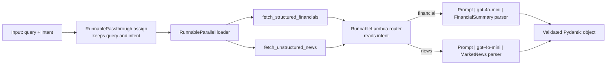

**To:** Lead Architect, NexusFlow AI  
**From:** Mohamed Emad  
**Subject:** FinCorp RAG orchestration: parallel retrieval, intent routing and Pydantic contracts (PoC architecture)

Hi,

Below is the strategy behind the FinCorp proof of concept, with the functional
LCEL stub in `workflow_architecture.py`. In short: we fetch both data sources
**concurrently**, **route** each request to a dedicated chain, and force every
LLM answer through a **Pydantic contract** so that nothing malformed reaches
FinCorp's reporting tools.

## 1. Architecture at a glance

## 2. Linear chain vs router chain

A linear chain runs the same steps in the same order for every request. With
two output contracts, that leaves two options, both weak: one prompt that
tries to serve both contracts (longer, more ambiguous, and the model can mix
the fields), or every request passing through both extraction steps (twice the
LLM cost and latency, and one of the two outputs is discarded).

A router chain separates the decision from the work. A `RunnableLambda` reads
`intent` and returns the matching chain; LangChain then invokes only that
chain.

| | Linear chain | Router chain (proposed) |
|---|---|---|
| LLM calls per request | 1 (shared prompt) or 2 (both branches) | Always 1 |
| Prompt and parser | Shared, so generic | Specialised per contract |
| Adding a new source | Edit the shared prompt | Add one chain and one route |
| Unknown request type | Silently mishandled | Explicit `ValueError` |

Trade-offs: a router needs the intent upstream. In this PoC it is an input
field, as in the provided test input; in production a classifier step would
set it and is the natural next component. Routing also adds one more piece to
maintain.

## 3. Parallel execution

The two retrieval calls do not depend on each other, so `RunnableParallel`
runs them together. Total retrieval time becomes the slowest call instead of
the sum of both. Retrieval is I/O-bound, so this gain grows with real network
latency.

What I verified: with two simulated 0.5 s fetches, the loader returned in
about 0.5 s (a sequential run would take about 1.0 s), and the two branches ran
on separate threads. What I have not measured: real gains against FinCorp's
actual sources, since the PoC uses mock functions. One cost to note: both
sources are fetched even though only one feeds the chosen chain. I kept that
because the brief asks for concurrent retrieval, and requests such as the
sample query ("impact of generative AI on Q4 margins") plausibly need both
kinds of data. If most requests need only one source, routing before
retrieval would avoid the wasted fetch.

## 4. How the Pydantic contracts stop noise and hallucinations

`FinancialSummary` and `MarketNews` mirror the approved schema and work at
three points:

1. **Instruct:** the `Field` descriptions go into the parser's format
   instructions, so the model is told the exact field names, types and
   formats ("Q3 2023", figures in millions).
2. **Constrain:** the quarter must match `^Q[1-4] \d{4}$`, the sentiment score
   must lie in [-1.0, 1.0], and `top_headlines` must have exactly 3 items.
3. **Reject:** `PydanticOutputParser` validates the reply and raises an error
   on any mismatch, so a malformed answer stops at the parsing step instead of
   reaching the dashboard.

Tests confirm this: a bad quarter format, an out-of-range score, 2 or 4
headlines, and a reply missing fields are all rejected.

**Limitation you should know about.** A contract guarantees the *shape* of the
data, not its *truth*. In live runs on the Groq-hosted model (see section 6) with our mock records
(which contain no company name and no net income), the model satisfied the
required fields with placeholders (such as `UNKNOWN` and `0.0`). Both are schema-valid, but a net income of
`0.0` looks like a real figure. Proposed mitigations, none implemented yet:
agree with FinCorp on an explicit "not reported" representation for fields the
sources do not contain, check extracted numbers against the retrieved text,
and retry on validation failure.

## 5. Implementation notes

- `route_query` takes an extra `chains` argument, bound with
  `functools.partial`, so the router can reach the chains built inside
  `build_fincorp_pipeline()` without global variables.
- `RunnablePassthrough.assign` keeps `query` and `intent` next to the
  retrieved data, which the router and prompts both need.
- `build_fincorp_pipeline` accepts an optional model so tests can inject a
  fake one. The default is `gpt-4o-mini`. The optional `LLM_MODEL` and
  `LLM_BASE_URL` environment variables point it at another
  OpenAI-compatible provider, which is how the development runs in
  section 6 were made. API keys come from the environment.

## 6. Status and testing environment

- **Verified by offline tests (8 passed):** each intent returns the correct
  model with exactly one LLM call; an invalid or missing intent raises a clear
  error; retrieval runs concurrently; schema constraints reject bad values.
- **Live runs, on a different model:** I could not run the pipeline against
  `gpt-4o-mini`. No OpenAI API key was available to me during development, so
  the live runs used Groq's OpenAI-compatible endpoint with the model
  `openai/gpt-oss-120b`, configured through `LLM_BASE_URL` and `LLM_MODEL`. On
  that model, the `financial` and `news` intents each returned the correct
  Pydantic object, and an invalid intent raised the expected error.
- **Not verified:** behaviour on `gpt-4o-mini` itself. The default
  configuration targets it, but I have not run it, so output quality, latency
  and the placeholder behaviour described in section 4 may differ on that
  model.

## 7. Questions

1. How should the contract represent a value that is genuinely absent from the
   sources (null, or a flagged default)?
2. Where should intent classification live in the production design?

Best regards,  
Mohamed Emad
