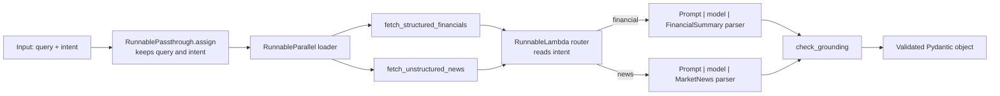

**To:** Lead Architect, NexusFlow AI  
**From:** Mohamed Soliman  
**Subject:** FinCorp RAG orchestration: parallel retrieval, intent routing and Pydantic contracts (PoC architecture and real-run evidence)

Hi,

Below is the strategy behind the FinCorp proof of concept, with the functional
LCEL stub in `workflow_architecture.py`. In short: we fetch both data sources
**concurrently**, **route** each request to a dedicated chain, and force every
LLM answer through a **Pydantic contract** plus a **grounding check**, so that
nothing malformed or unsupported reaches FinCorp's reporting tools.

## 1. Architecture at a glance

## 2. Linear chain vs router chain

A linear chain runs the same steps in the same order for every request. With
two output contracts, that leaves two options, both weak: one prompt that
tries to serve both contracts (longer, more ambiguous, and the model can mix
the fields), or every request passing through both extraction steps (twice the
LLM cost and latency, and one of the two outputs is discarded).

A router chain separates the decision from the work. A `RunnableLambda` reads
`intent` and returns the matching chain; LangChain then invokes only that
chain.

| | Linear chain | Router chain (proposed) |
|---|---|---|
| LLM calls per request | 1 (shared prompt) or 2 (both branches) | Always 1 |
| Prompt and parser | Shared, so generic | Specialised per contract |
| Adding a new source | Edit the shared prompt | Add one chain and one route |
| Unknown request type | Silently mishandled | Explicit `ValueError` |

Trade-offs: a router needs the intent upstream. In this PoC it is an input
field, as in the provided test input; in production a classifier step would
set it and is the natural next component. Routing also adds one more piece to
maintain.

## 3. Parallel execution

The two retrieval calls do not depend on each other, so `RunnableParallel`
runs them together. Total retrieval time becomes the slowest call instead of
the sum of both. Retrieval is I/O-bound, so this gain grows with real network
latency.

What I verified: with two simulated 0.5 s fetches (offline test), the loader
returned in about 0.5 s (a sequential run would take about 1.0 s), and the two
branches ran on separate threads. What I have not measured: real gains against
FinCorp's actual sources, since the PoC uses mock functions. The elapsed times
in the real run (section 5) are LLM call times, not retrieval times. One cost
to note: both sources are fetched even though only one feeds the chosen chain.
I kept that because the brief asks for concurrent retrieval, and requests such
as the sample query ("impact of generative AI on Q4 margins") plausibly need
both kinds of data. If most requests need only one source, routing before
retrieval would avoid the wasted fetch.

## 4. How the Pydantic contracts stop noise and hallucinations

`FinancialSummary` and `MarketNews` mirror the approved schema and work at
three points:

1. **Instruct:** the `Field` descriptions go into the parser's format
   instructions, so the model is told the exact field names, types and
   formats ("Q3 2023", figures in millions).
2. **Constrain:** the quarter must match `^Q[1-4] \d{4}$`, the sentiment score
   must lie in [-1.0, 1.0], and `top_headlines` must have exactly 3 items.
3. **Reject:** `PydanticOutputParser` validates the reply and raises an error
   on any mismatch, so a malformed answer stops at the parsing step instead of
   reaching the dashboard.

**What a contract cannot do.** It guarantees the *shape* of the data, not its
*truth*. Any string is a valid `company_name`, and any float is a valid
`net_income`. So a second layer sits behind the parser:

- **Prompt rule:** both prompts say to use only values stated in the source or
  the query, never to guess, and never to use placeholders such as `UNKNOWN`
  or `0`.
- **`check_grounding` (default on, `enforce_grounding=False` turns it off):**
  after parsing, it raises `UngroundedValueError` if the company name is a
  placeholder or does not appear in the retrieved text or the query, if the
  quarter and year are not both present in them, or if `total_revenue` or
  `net_income` do not match a `$` amount in the record (0.5% tolerance).
  For news it checks the company name only.

The check is a simple text match. It cannot judge a sentiment score or a
headline's meaning, and it cannot tell a correct number from a coincidental
one.

## 5. Real-run evidence

The full output of a live run is saved in `evidence/real_run_output.txt`
(produced by `run_evidence.py`). It contains, for each case, the prompt sent,
the raw model output, the API metadata and the outcome.

**Model and endpoint, stated plainly:** the run used **Groq's
OpenAI-compatible endpoint (`api.groq.com`) with `openai/gpt-oss-120b`**, not
`gpt-4o-mini`. I had no OpenAI key. The default in the code is still
`gpt-4o-mini`; I have not run it. Run date: 2026-11-08 (UTC), langchain-core
1.7.4, langchain-openai 1.7.3, pydantic 2.14.2. The key is not recorded in
the file.

| Case | Intent | Grounding check | Records | Outcome |
|---|---|---|---|---|
| A1 | financial | off | mock | Parser error: the model answered in prose that the data was missing |
| A1 | news | off | mock | Accepted. `company_name` = "FinCorp", which is not in the source; one headline repeated 3 times |
| A2 | financial | off | mock | Parser error: the model returned `{"error": ...}`, 4 required fields missing |
| A2 | news | off | mock | Accepted. `company_name` = "" (empty); one headline repeated 3 times |
| B | financial | on | mock | Parser error (prose answer); the grounding check was never reached |
| B | news | on | mock | **Rejected by the grounding check:** `company_name='FinCorp'` is not in the source or the query |
| C | financial | on | complete test | Accepted: FinCorp Inc., Q3 2023, revenue 45000.0, net income 9200.0 |
| C | news | on | complete test | Accepted: FinCorp Inc., score 0.85, 3 distinct headlines from the source |
| D | invalid (`weather`) | on | none | `ValueError: Unsupported or missing intent` (no model call) |

"Mock" is the PoC's own mock record, which has no company name, quarter year
or net income. "Complete test" records were written by me for this run to give
the model a source that contains every field; they are not FinCorp data.

What the run shows, and what it does not:

1. **In the saved run, `UNKNOWN` and `0.0` did not appear.** That run used
   the prompt with the explicit anti-placeholder rule. The earlier version of
   this proposal said the model filled the missing fields with those
   placeholders; that came from an earlier development run whose output I did
   not save, so I removed it as a finding. On the financial intent the model
   refused instead (3 of 3 calls). The probe below tests what happens when
   the rule is removed.
2. **The contract alone let unsupported values through.** In A1 (news) it
   accepted an invented company name, and in A2 (news) an empty one. The
   placeholder detector inside `run_evidence.py` reported "none" for both,
   because it only looks for words like `UNKNOWN` and `0.0`. An empty string
   is not in its list.
3. **The grounding check caught the invented name in B (news).** By code
   reading, it would also reject the empty name from A2, since an empty string
   never appears in the source; no test and no live call exercised that case.
   This is not a controlled comparison: each case is one or two calls, and
   the outputs differ from call to call (A1 gave "FinCorp", A2 gave "").
   One plausible reason for "FinCorp" is that the prompt itself starts with
   "You are ... for FinCorp"; that is my inference, not something the run proves.
4. **On the financial intent, the contract acted as a hard stop.** With the
   mock record the model never produced JSON, and the parser raised an error
   (A1, A2, B), so nothing reached a downstream tool. The guard's financial
   checks (quarter, year, amounts) were only exercised live in C, where they
   passed. Their rejection behaviour is covered by offline tests only.
5. **"Exactly 3 headlines" pushed the model to pad.** When the source had one
   headline, it repeated it three times (A1 and A2 news). The shape is valid;
   the information is not. The grounding check does not catch this.
6. **With complete records, both intents returned grounded answers** (C), and
   the grounding check passed them.

### Placeholder probe: the same records, prompts without the rule

`probe_placeholders.py` sends the same mock records 5 times per intent with
prompts that do not contain the two sentences forbidding guesses and
placeholders, and with no grounding check. The full output (prompt, raw
output and API metadata of every call) is in
`evidence/placeholder_probe.txt`. Same model and endpoint as above (Groq,
`openai/gpt-oss-120b`), run on 2026-11-08 (UTC).

| Intent | Calls | Refused (parse error) | Accepted by the contract | Amount of `0.0` | Value not in the source |
|---|---|---|---|---|---|
| financial | 5 | 1 | 4 | 4 | 4 |
| news | 5 | 0 | 5 | 0 | 5 |

- **Financial:** the 4 accepted answers were identical: `company_name`
  "FinCorp", `quarter` "Q4 2023", `total_revenue` 45000.0, `net_income` 0.0.
  The company name, the year 2023 and the net income are not in the record or
  the query. The `0.0` is the placeholder the platform feedback described, and
  it is reproduced here once the rule is removed. `UNKNOWN` did not appear in
  any of the 10 calls.
- **News:** all 5 answers named "FinCorp", which the source does not contain.
  The source is one sentence; the model wrote three distinct headlines that
  add claims beyond it (for example about lifting Q4 profit margins). The
  grounding check does not look at headlines.
- **Every answer the contract accepted (9 of 9) contained at least one value
  the source does not support**, and the same check that the pipeline uses
  flags each of them.
- **How far to trust this:** the prompt is a reconstruction (the current
  prompt minus the rule), not the original text. It is one model. At
  temperature 0 the repeats are almost identical (the 4 financial answers
  were the same), so this is one observed behaviour repeated, not 5
  independent trials. The comparison with the saved run is not controlled:
  with the rule, the financial intent gave values in 0 of 3 calls (3
  refusals); without it, in 4 of 5. That is consistent with the rule helping
  on the financial intent, but it does not prove it. On the news intent the
  rule did not stop the invented or empty company name (cases A1 and A2), so
  the grounding check is still needed.

## 6. Implementation notes

- `route_query` takes an extra `chains` argument, bound with
  `functools.partial`, so the router can reach the chains built inside
  `build_fincorp_pipeline()` without global variables.
- `RunnablePassthrough.assign` keeps `query` and `intent` next to the
  retrieved data, which the router and prompts both need. With the grounding
  check on, it also keeps the retrieved text next to the parsed answer so the
  check can compare them.
- `build_fincorp_pipeline` accepts an optional model, and optional fetchers,
  so tests can inject fakes. The default model is `gpt-4o-mini`. The optional
  `LLM_MODEL` and `LLM_BASE_URL` environment variables point it at another
  OpenAI-compatible provider, which is how the run in section 5 was made. API
  keys come from the environment and are never committed.

## 7. Status and testing

- **Offline tests** (`python -m pytest -q`): they cover routing with
  exactly one LLM call per intent, invalid-intent errors, concurrent
  retrieval, schema limits, the grounding check and the submission
  checks. They use a fake model, so they show the wiring, not model
  behaviour.
- **Skipped:** the two live tests, which need `OPENAI_API_KEY` in the
  environment. I do not count them as evidence; the evidence is the file in
  section 5.
- **Not verified:** behaviour on `gpt-4o-mini`, behaviour on FinCorp's real
  sources, and any larger or more varied sample than the calls above
  (1 to 2 per case in the main run, 5 per intent in the probe, at
  temperature 0).

## 8. Questions

1. How should the contract represent a value that is genuinely absent from the
   sources (null, or an explicit "not reported" flag)? In the run, the model
   answered in prose or an error object rather than JSON when it had nothing to
   fill in.
2. Should `top_headlines` allow fewer than 3 items, so the model is not forced
   to repeat one?
3. Where should intent classification live in the production design?

Best regards,  
Mohamed Soliman
